<div align="center">
  <picture>
    <source media="(prefers-color-scheme: dark)" srcset="assets/logo-white.png" />
    <source media="(prefers-color-scheme: light)" srcset="assets/logo-black.png" />
    
  </picture>

  <h1>🤖 discord-agy-bridge</h1>

  <p>
    <strong>Turn a Windows PC running Antigravity CLI (<code>agy</code>) into an all-in-one Discord AI Assistant, Server Management Bot &amp; Automation Hub.</strong>
  </p>

  <p>
    
    
    
    
    
    
  </p>

  <p>
    🇬🇧 <strong>English</strong> &nbsp;·&nbsp; 🇻🇳 <a href="./README.vi.md">Tiếng Việt</a>
  </p>

  <p>
    <a href="#highlights">✨ Highlights</a> &nbsp;·&nbsp;
    <a href="#architecture">🏗️ Architecture</a> &nbsp;·&nbsp;
    <a href="#features">⚡ Features</a> &nbsp;·&nbsp;
    <a href="#security">🛡️ Security</a> &nbsp;·&nbsp;
    <a href="#quick-start">🚀 Quick Start</a> &nbsp;·&nbsp;
    <a href="#commands">⌨️ Commands</a> &nbsp;·&nbsp;
    <a href="#handoff">🤖 Handoff</a>
  </p>
</div>

---

<a id="highlights"></a>
## ✨ Why `discord-agy-bridge`?

| 🚧 The Problem | 💡 How `discord-agy-bridge` Solves It |
| :--- | :--- |
| 📱 **Antigravity has no standalone chat/mobile app** for quick daily conversations, screenshots, and file handoffs. | **Discord becomes your native AI app:** Chat from phone or desktop via DM, channels, or auto-Threads with `26` `/` commands, live tool streaming, latest-message Action Buttons, `25 MB` two-way media, Office/PDF exports, and Cloud TTS. |
| 🔐 **Sharing a host CLI safely with others is hard** — private folders, secrets (`config.json`), or unsandboxed shells can leak. | **Two-layer RBAC + Default-Deny Guard:** Auto-provisions private `#ai-<user>` rooms, `--sandbox` workspaces, per-channel temp/attachments, and a `PreToolUse` hook that blocks unauthorized MCPs and `BypassSandbox: true`. |
| 🧩 **Running 5+ fragmented Discord bots** for welcomes, private rooms, guides, cron jobs, webhooks, and music creates clutter. | **All-in-one server bot (`0` AI tokens for server ops):** Built-in auto-onboard/offboard, transparent PNG `#announcement` cards, read-only `#instructions`, daily `#admin` reports, Cron/Webhooks, and Opus `/play` Voice music. |

> [!TIP]
> **Lightweight by design:** Pure Node.js v22+ with **`0 node_modules`** inside the repository, **`~74 MB`** idle RAM, **`0` AI tokens** spent on server management & Voice playback, and **`50/50`** zero-dependency unit tests.

---

<a id="architecture"></a>
## 🏗️ System Architecture

<div align="center">
  <picture>
    <source media="(prefers-color-scheme: dark)" srcset="assets/diagrams/architecture-dark.svg" />
    <source media="(prefers-color-scheme: light)" srcset="assets/diagrams/architecture-light.svg" />
    
  </picture>
  <p><sub>📐 Code-backed architecture diagram generated &amp; verified with <strong>Archify</strong> (auto-switches Light / Dark theme).</sub></p>
</div>

- 🟢 **Ingress & Priority Queue (`bot.mjs`, `lib/discord-gateway.mjs`, `lib/runner.mjs`):** Custom WebSocket Gateway with heartbeat/resume watchdog, `26` Slash Commands, Action Buttons, and a Priority Semaphore (`User > Webhook > Cron`) with Windows sleep prevention.
- 🔴 **2-Layer Trust Boundary (`lib/auth.mjs`, `lib/quota.mjs`, `lib/guard.mjs`):** Every message passes RBAC + daily quota checks before spawning `agy.exe`; non-admin runs are locked in `--sandbox` and filtered by the `PreToolUse` default-deny hook.
- 🔵 **4-MCP Tool Layer & Voice Engine (`lib/desktop.mjs`, `lib/music.mjs`):** Routes Admin tasks cleanly across Desktop GUI, headless UIA, Firecrawl Cloud, and Chrome AM (`:9229`), while `/play` streams Opus audio via `@discordjs/voice` + DAVE at zero AI token cost.

---

<a id="features"></a>
## ⚡ Core Features

### 💬 1. AI Assistant & Two-Way File Pipeline
* **⌨️ 26 Native Slash Commands + Autocomplete:** Type `/` for descriptions and live autocomplete across models, projects, cron IDs, webhook IDs, and `/play` controls.
* **🎛️ Clean Latest-Message Action Buttons:** `[🔄 Retry]`, `[📝 Short Summary]`, `[🆕 New Session]`, and `[🗑️ Delete Thread]` automatically strip themselves from older messages so chat stays tidy.
* **📡 Live Progress Streaming & Thread Sync:** Displays active steps (`Read`, `Edit`, `Run`, `Chrome AM`) with an instant `[⏹️ Stop Now]` button (`taskkill /T /F` on Windows). Supports `/autothread on`, full **Reply** context + attachment extraction, and synced deletion between Discord Threads, starter messages, and `agy` conversations.
* **📎 Multimedia, Office & Cloud TTS:** Accepts up to `25 MB` attachments from Discord; generates and returns `.pptx`, `.xlsx`, `.docx`, `.pdf`, `.html`, `.zip`, `.svg`, Markdown images, and Cloud TTS `.mp3` files (`delete_after_send` supported).

### 🏛️ 2. Multi-Purpose Discord Server Bot (`0` AI Tokens)
| Module | What It Does |
| :--- | :--- |
| 👋 **Auto-Onboard & Private Rooms** (`lib/onboard.mjs`) | On `GUILD_MEMBER_ADD` (or `/access onboard`), creates a private `#ai-<user>` channel (hidden from `@everyone`) + sandbox directory and sends a welcome guide; auto-revokes on leave. Supports `/access private`, per-member model lock (`/access model`), and Admin `/clear` in `#free-chat` & `#announcement`. |
| 🎨 **Announcement Cards & Guide Sync** (`lib/announce-card.mjs`) | Renders transparent PNG join/leave banners with green/red circular avatars and live member counts into `#announcement`, and syncs a read-only member guide to `#instructions`. |
| 📊 **Quotas & Daily Admin Reports** (`lib/quota.mjs`, `lib/report.mjs`) | Enforces daily turn/token limits, cooldowns, and workspace MB caps; delivers zero-token end-of-day usage, disk, and security summaries to `#admin`. |
| 🎵 **Voice Music Player (`/play`)** (`lib/music.mjs`) | Open to all members in `#free-chat`, Voice text chats, and private rooms. Plays links & playlists from **YouTube**, **YouTube Music**, **SoundCloud**, **Spotify** (embed metadata), direct URLs, and song search. Compact Embed with `5` live buttons (`⏸️ Pause` · `⏭️ Skip` · `➡️/🔀/🔂/🔁 Play Mode` · `🧹 Clear` · `⏹️ Stop`), `yt-dlp --no-cache-dir`, `ffmpeg -c:a copy` Opus passthrough, `2h` stream URL TTL refresh, and auto-leave on empty room (`1m`), finished queue (`2m`), or long pause (`10m`). |

### 🖥️ 3. Smart 4-MCP Desktop & Web Routing (Admin)
| MCP Server | Best Used For | Key Capabilities |
| :--- | :--- | :--- |
| 🪟 **`discord-bridge-desktop`** | Persistent GUI launches, uploads & TTS | `8` authenticated host tools (`open_in_chrome`, `open_app`, `open_desktop_target`, `send_to_discord`, `text_to_speech`, `capture_desktop`, `desktop_clipboard`, `desktop_windows`) over an ephemeral loopback Bearer bridge (`127.0.0.1:0`). |
| 🖱️ **`agent-desktop`** | Reading & operating Windows app UIs | Native Windows UIA tree (`desktop_snapshot`, `desktop_find`, `desktop_click`, `desktop_set_value`, Windows Notifications) running headless without stealing focus. |
| 🔥 **`firecrawl`** | Public URLs, docs & PDFs (no login) | Fast Cloud scraping, parsing, and search (`firecrawl_scrape`, `firecrawl_parse`, `firecrawl_search`) without popping up any browser window. |
| 🌐 **`chrome-devtools` (Chrome AM)** | Logged-in sites & interactive SPAs | Isolated Chrome profile (`%LOCALAPPDATA%\Google\Chrome AM User Data`, debug port `9229`) with pre-check before launch for authenticated workflows & live UI screenshots. |

### ⚙️ 4. Automation Hub — Cron & Local HTTP Webhooks
* **⏰ Persistent Cron Scheduler (`lib/cron.mjs`):** Run scheduled one-shot or recurring AI tasks (`every 30m`, `in 15m`, `daily 08:30`, or 5-field POSIX cron) saved in `state.json` — e.g. `/cron add "daily 08:30" "Use firecrawl_search to summarize top tech news today"`.
* **🪝 Authenticated HTTP Webhook Server (`lib/webhook.mjs`):** Binds to `127.0.0.1:3939` by default; supports Bearer, `X-Webhook-Secret`, and HMAC-SHA256 (`X-Hub-Signature-256`) verification, minimal unauthenticated `GET /health` (`{"ok":true}`), `15s` request timeout, rate limiting, deduplication (`dedupWindowSec`), `<untrusted_webhook_payload>` prompt-injection framing, and non-admin diagnosis Threads.

---

<a id="security"></a>
## 🛡️ Security Model & Two-Layer RBAC

<div align="center">
  <picture>
    <source media="(prefers-color-scheme: dark)" srcset="assets/diagrams/security-flow-dark.svg" />
    <source media="(prefers-color-scheme: light)" srcset="assets/diagrams/security-flow-light.svg" />
    
  </picture>
  <p><sub>🔒 Sequence of RBAC authorization, <code>PreToolUse</code> default-deny enforcement, and <code>#admin</code> audit alerts (Archify).</sub></p>
</div>

| Capability | 👑 Admin | 👤 Member (`#ai-<user>`) | 🪝 Webhook Thread |
| :--- | :---: | :---: | :---: |
| DM & Full `26` Slash Commands | ✅ | ❌ (`8` member cmds only) | ❌ |
| Workspace Isolation (`--sandbox`) | Optional | 🔒 Forced locked `cwd` | 🔒 Forced locked `cwd` |
| `send_to_discord` & `text_to_speech` | ✅ Full | 🔒 Scoped to `cwd` & channel temp | 🔒 Scoped to `cwd` & channel temp |
| `firecrawl` Cloud Tools | ✅ | ⚙️ Opt-in (`allowFirecrawl`) | ⚙️ Opt-in (`allowFirecrawl`) |
| `agent-desktop`, Chrome AM, `schedule`, `run_workflow`, unknown MCPs | ✅ | ❌ Blocked by `PreToolUse` | ❌ Blocked by `PreToolUse` |
| `BypassSandbox: true`, UNC paths, symlink escapes, `config.json` | 🛡️ `config.json` upload blocked | ❌ Blocked + killed + `#admin` alert | ❌ Blocked + killed + `#admin` alert |

> [!IMPORTANT]
> **Security Boundary Note:**
> * `hook-guard.cmd` exits immediately (`exit /b 0`) outside Discord bridge sessions so your normal IDE workflow keeps zero overhead and default permissions.
> * Application-level sandboxing (`--sandbox`, canonical path/UNC/junction checks, per-channel temp/attachments, and `PreToolUse` default-deny) is designed for **friends, family, and trusted groups** sharing a personal Windows host. Because all runs share one Windows user account, do **not** treat it as VM/OS-level isolation for untrusted public internet users; keep `webhook.host` bound to `127.0.0.1` unless placed behind an authenticated reverse proxy or tunnel.

---

<a id="quick-start"></a>
## 🚀 Quick Start (Fresh Windows PC)

### 📋 Prerequisites
* 🪟 **OS:** Windows 10 / 11 *(Desktop, Chrome AM & Task Scheduler target Windows; Gateway & Voice use standard Node.js)*
* 🟢 **Node.js:** `v22+` (`v24.6.0` verified with native `aes-256-gcm` for Discord Voice)
* 🤖 **Antigravity CLI:** `agy.exe` installed and OAuth-authenticated
* 🎬 **FFmpeg:** Installed at `C:\ffmpeg\ffmpeg.exe` (or on `PATH`) for `/play` Voice audio

### 1️⃣ Clone & Create `config.json`
```powershell
git clone https://github.com/namtit2932k/discord-agy-bridge.git
cd discord-agy-bridge
Copy-Item config.example.json config.json
```
Edit `config.json` *(keep every Discord Snowflake ID as a string `"..."`)*:
* `botToken`: From [Discord Developer Portal](https://discord.com/developers/applications) with **Privileged Gateway Intents** (`Message Content Intent`, `Server Members Intent`) enabled and permissions: `View Channel`, `Send Messages`, `Read Message History`, `Manage Messages`, `Manage Channels`, `Manage Roles`, `Connect`, `Speak`.
* `allowedUserId`: Root Admin's Discord User ID.
* `allowedChannelIds`, `agyPath`, `defaultCwd`, `autoOnboard.rootDir`: Paths and channel IDs matching your host/server.

### 2️⃣ Install Shared External Tools (`C:\ProgramData\agy-shared-tools`)
The repository stays clean with **`0 node_modules`**. Voice & document libraries live in a shared folder readable by sandboxed `agy` runs:
```powershell
New-Item -ItemType Directory -Force -Path "C:\ProgramData\agy-shared-tools\bin" | Out-Null
cd "C:\ProgramData\agy-shared-tools"
npm init -y
npm install @discordjs/voice @snazzah/davey prism-media opusscript
# Optional for sandboxed AI Office/PDF exports:
# npm install pptxgenjs exceljs xlsx docx pdfkit archiver

# Download yt-dlp.exe
Invoke-WebRequest -Uri "https://github.com/yt-dlp/yt-dlp/releases/latest/download/yt-dlp.exe" `
  -OutFile "C:\ProgramData\agy-shared-tools\bin\yt-dlp.exe"

# Grant read & execute permissions for Windows sandboxed agy runs
icacls "C:\ProgramData\agy-shared-tools" /grant "*S-1-15-2-1:(OI)(CI)(RX)" /T
```

### 3️⃣ Verify & Launch
```powershell
# Canonical 1-command health check (syntax, 50 tests, config/MCP/hook/PID/hygiene)
node scripts/verify.mjs

# Foreground run with live console logs
.\start.bat
```
For background autostart on logon, register a Windows Task Scheduler task named `AntigravityDiscordBridge` (`Logon Mode: Interactive only`) running `wscript.exe //B "<path>\run-hidden.vbs"`. Restart after updates with:
```powershell
.\stop.bat
schtasks /Run /TN "AntigravityDiscordBridge"
```

---

<a id="commands"></a>
## ⌨️ Slash Commands (`26`)

### 👥 Member Commands (`8`)
| Command | Purpose |
| :--- | :--- |
| 🎵 `/play <link-media> [voice]` | Play tracks/playlists (YouTube, YT Music, SoundCloud, Spotify, search) in Voice; actions: `queue`, `skip`, `clear`, `shuffle`, `repeat`, `repeat-one`, `sequential`, `pause`, `resume`, `stop` *(works in `#free-chat`, Voice chats & private rooms)* |
| ❓ `/help` | List commands filtered by the caller's role |
| 📊 `/status` | Inspect active model, session & RBAC policy |
| 📈 `/usage` | Check token usage and remaining daily quota |
| 🆕 `/new` | Start a fresh AI conversation (keeps project & model) |
| ⏹️ `/stop` | Immediately abort the running AI turn |
| 🧹 `/clear [count]` | Clear non-Thread messages in your room *(Admin can also clear `#free-chat` & `#announcement`)* |
| 🗑️ `/delete` | Delete the current Thread along with its starter message & session |

<details>
<summary>👑 <strong>Admin-Only Commands (<code>18</code> commands, <code>default_member_permissions: "8"</code>) — click to expand</strong></summary>

<br />

| Category | Commands |
| :--- | :--- |
| 🧠 **Workspace & Model** | `/projects`, `/project`, `/models`, `/model`, `/mode`, `/sandbox` |
| 🛡️ **Access & Guides** | `/access` (`list`, `onboard`, `offboard`, `auto`, `private`, `channel`, `revoke`, `admin`, `model ...`, `quota ...`, `security ...`, `report ...`), `/guide [reset]`, `/reload` |
| 🖥️ **Desktop & Diagnostics** | `/chrome <status\|close>`, `/windows <list\|focus\|close>`, `/logs [lines]`, `/cleanup` |
| ⚙️ **Automation & UI** | `/cron`, `/webhook`, `/footer`, `/autothread`, `/stream` |

</details>

---

<a id="handoff"></a>
## 🤖 Repository & Agent Handoff

<details>
<summary>📁 <strong>Repository Structure — click to expand</strong></summary>

```text
discord-agy-bridge/
├── assets/
│   ├── logo-white.png / logo-black.png   # Dual-theme transparent logos
│   └── diagrams/                         # Code-backed Archify dual-theme SVGs
│       ├── architecture-{dark,light}.svg
│       └── security-flow-{dark,light}.svg
├── bot.mjs                               # Central orchestrator, Gateway dispatch, --mcp-stdio, --hook-guard
├── hook-guard.cmd                        # Zero-overhead Windows PreToolUse wrapper (no-op outside bridge)
├── lib/
│   ├── announce-card.mjs                 # Transparent PNG join/leave cards (.NET System.Drawing)
│   ├── auth.mjs                          # RBAC policy, MEMBER_ALLOWED_COMMANDS, allowFirecrawl & MCP scope
│   ├── cron.mjs                          # Persistent cron scheduler (every / in / daily / 5-field POSIX)
│   ├── desktop.mjs                       # 8 host MCP tools, Chrome AM (:9229), per-channel temp, capture & TTS
│   ├── discord-gateway.mjs               # Custom WebSocket Gateway client (Heartbeat, Resume, Watchdog, Intents)
│   ├── guard.mjs                         # Default-deny PreToolUse RBAC guard & protected-process shield
│   ├── music.mjs                         # Voice player, playlist resolver, 4 modes, 2h TTL & Opus passthrough
│   ├── onboard.mjs                       # Auto-onboard/offboard private #ai-<user> rooms & sandbox folders
│   ├── quota.mjs                         # Daily turns/tokens, cooldown & workspace disk quota
│   ├── report.mjs                        # Zero-token daily #admin summaries & security alert stats
│   ├── runner.mjs                        # Priority queue semaphore, sleep inhibitor, 4-MCP prompt routing
│   ├── slash.mjs                         # 26 Slash Command schemas, parser & dynamic autocomplete
│   ├── utils.mjs                         # 64-bit Snowflake quoting, atomic JSON, UNC/symlink path safety
│   └── webhook.mjs                       # Local HTTP webhook server (Bearer/HMAC, untrusted payload framing)
├── scripts/verify.mjs                    # 1-command health check (syntax, 50 tests, config/MCP/hook/PID/hygiene)
├── test/                                 # Zero-dependency Node test suite (50 tests via node --test)
├── config.example.json                   # Config template (copy to config.json locally, NEVER commit)
├── run-hidden.vbs / start.bat / stop.bat # Windows Task Scheduler launcher & lifecycle scripts
├── AGENTS.md / CLAUDE.md / GEMINI.md     # Multi-agent handoff playbook & context pointers
└── CHANGELOG.md                          # Chronological change log (newest at top)
```

</details>

> [!NOTE]
> **60-Second Onboarding for Developers & AI Agents:**
> 1. 📖 Read [`AGENTS.md`](./AGENTS.md) and the top 30–60 lines of [`CHANGELOG.md`](./CHANGELOG.md), then run `node scripts/verify.mjs` before changing anything.
> 2. 🔑 **Never read, print, or commit `botToken`** inside `config.json`.
> 3. 🖥️ **Never launch GUI apps from IDE shells** (`WinSta0\exebox-...`); GUI launches belong to the interactive Task Scheduler `bot.mjs` daemon.
> 4. ✅ **Definition of Done:** Prepend an entry to [`CHANGELOG.md`](./CHANGELOG.md), update [`AGENTS.md`](./AGENTS.md) on architectural changes, pass `node scripts/verify.mjs`, and restart runtime changes via `.\stop.bat` → `schtasks /Run /TN "AntigravityDiscordBridge"`.
