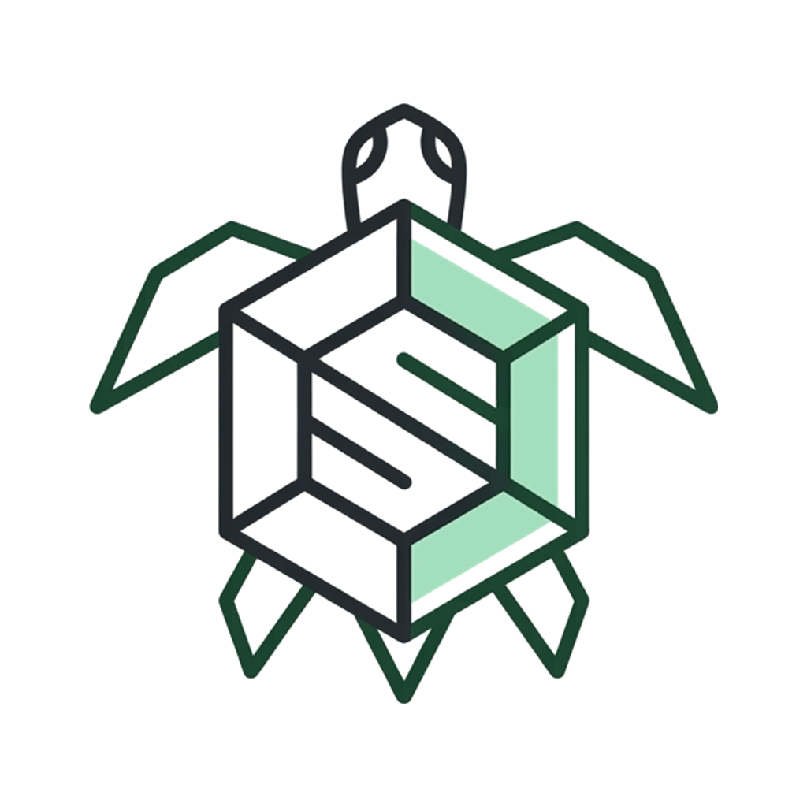

<div align="center">
  
  <h1>discord-agy-bridge</h1>
  <p><strong>Biến máy tính Windows cài Antigravity CLI (<code>agy</code>) thành Trợ lý AI qua Discord, Bot quản lý Server đa nhiệm &amp; Automation Hub.</strong></p>
  <p>
    
    
    
    
  </p>
  <p>
    <a href="./README.md">English</a> &nbsp;·&nbsp; Tiếng Việt
  </p>
</div>

---

## 1. Tổng quan & Bài toán dự án giải quyết

### Vấn đề ban đầu
1. **Antigravity chưa có app riêng:** Dù có thể thao tác từ xa, Antigravity hiện chưa có một ứng dụng nhắn tin / mobile app độc lập để mở nhanh hàng ngày trên điện thoại hay máy tính, chat tự nhiên, thả ảnh/tài liệu và nhận lại kết quả gọn gàng như một app chat quen thuộc.
2. **Nhu cầu chia sẻ AI cho nhiều người dùng an toàn:** Nếu chia sẻ trực tiếp máy tính hoặc tài khoản CLI cho bạn bè / thành viên trong cộng đồng dùng chung, người dùng khác có thể vô tình hoặc cố ý truy cập thư mục hệ thống, đọc file bí mật (`config.json`), chạy lệnh vượt quyền (`BypassSandbox`) hoặc làm cạn kiệt tài nguyên.
3. **Sẵn tiện có bot Discord rồi thì gộp luôn toàn bộ tính năng quản lý server như các server lớn:** Một khi đã chạy bot Discord kết nối AI, việc mời thêm nhiều bot rời rạc chỉ để chào mừng thành viên, tạo kênh riêng, đồng bộ nội quy/hướng dẫn, dọn dẹp tin nhắn, hẹn giờ, nhận webhook hay phát nhạc Voice rất rườm rà. Vì vậy dự án gom luôn trọn bộ chức năng của một con bot quản lý server Discord chuyên nghiệp vào cùng một nơi.

### Cách `discord-agy-bridge` giải quyết
* **Dùng Discord làm app giao tiếp riêng cho Antigravity (`bot.mjs`, `lib/runner.mjs`):** Kết nối thẳng tới `agy.exe` (`~74 MB` RAM khi rảnh, không `node_modules` trong repo), biến DM, các kênh và Thread tự tạo trên Discord thành giao diện trò chuyện mượt mà với `26` Slash Commands `/`, stream tiến độ từng bước theo thời gian thực, cụm nút hành động luôn giữ ở tin nhắn mới nhất, ngữ cảnh Reply, gửi/nhận tệp 2 chiều (`25 MB`) + xuất Office/PDF/TTS và điều khiển Desktop thật + trình duyệt **Chrome AM** (`port 9229`) cho Admin.
* **Chia sẻ AI đa người dùng có cách ly (RBAC + Sandbox):** Thành viên mới vào server tự động được cấp kênh riêng `#ai-<tên>` và thư mục sandbox riêng (`--sandbox`, tắt quyền Desktop/Chrome, giới hạn lượt/token/cooldown/dung lượng ổ đĩa theo ngày, tự chặn và cảnh báo `#admin` nếu cố gọi `BypassSandbox`).
* **Bot quản lý server Discord đa nhiệm (`0` token AI cho tác vụ server):** Tự động onboarding/offboarding thành viên (`GUILD_MEMBERS`), đăng banner PNG trong suốt chào/tạm biệt vào `#announcement`, đồng bộ kênh hướng dẫn `#instructions` chế độ chỉ đọc cho `@everyone`, ẩn kênh riêng tư (`/access private`), dọn kênh `/clear` (gồm cả `#free-chat` cho Admin), báo cáo tổng kết cuối ngày, Automation Hub (`Cron` + `HTTP Webhook`) và hỗ trợ giải trí phát nhạc Voice (`/play`) nhẹ tài nguyên.

---

## 2. Kiến trúc tổng quát

```text
Discord (DM / Server Channels / Threads / Voice)
   │
   ▼  WebSocket Gateway + Slash Commands + Action Buttons (lib/discord-gateway.mjs, lib/slash.mjs)
┌──────────────────────────────────────────────────────────────────────┐
│                         bot.mjs (Điều phối trung tâm)                │
│  ├─ Kiểm tra quyền & Hạn mức RBAC (lib/auth.mjs, lib/quota.mjs)      │
│  ├─ Quản trị Server: Onboard, Banner, Guide (onboard, announce-card) │
│  ├─ Automation Hub: Cron & HTTP Webhook (lib/cron.mjs, webhook.mjs)  │
│  └─ Priority Queue Semaphore: User > Webhook > Cron (lib/runner.mjs) │
└───────┬───────────────────────────────┬──────────────────────┬───────┘
        │                               │                      │
        ▼                               ▼                      ▼
 Antigravity CLI (`agy`)      MCP Desktop Bridge        Discord Voice Engine
 - Model & Mode theo kênh     - Chrome AM (9229)        - yt-dlp (--no-cache-dir)
 - Stream JSON từng bước      - Windows App/Clipboard   - ffmpeg (-c:a copy Opus)
 - `--sandbox` cho Member     - Screenshot & Cloud TTS  - @discordjs/voice + DAVE
 - Shared quick-files libs    - send_to_discord (25MB)  - Auto-leave khi trống phòng
```

---

## 3. Chi tiết các nhóm chức năng chính

### A. Giao tiếp AI & Xử lý tệp 2 chiều (`bot.mjs`, `lib/runner.mjs`)
* **26 Slash Commands (`/`) + Action Buttons:** Gõ `/` để chọn lệnh có mô tả & autocomplete danh sách model, project, cron ID, webhook ID và tác vụ `/play`. Cụm nút dưới câu trả lời (`[🔄 Thử lại]`, `[📝 Tóm tắt ngắn]`, `[🆕 Phiên mới]`, `[🗑️ Xóa Thread]`) tự động gỡ khỏi tin nhắn cũ để chỉ hiện ở tin nhắn mới nhất.
* **Stream tiến độ & Cô lập Thread:** Hiện từng bước `agy` đang làm kèm nút `[⏹️ Dừng ngay]`; tự chống Windows Sleep khi đang xử lý AI. Hỗ trợ `/autothread on`, đồng bộ xóa Thread ↔ tin nhắn gốc ↔ conversation của `agy`, và đọc ngữ cảnh + tệp đính kèm khi **Reply** tin nhắn cũ.
* **Trao đổi file đa phương tiện & Quick Files:** Nhận ảnh, PDF, code, audio, video từ Discord (tối đa `25 MB`/tệp); AI xuất trả `.pptx`, `.xlsx`, `.docx`, `.pdf`, `.html`, `.zip`, `.svg`, ảnh Markdown và âm thanh Cloud TTS `.mp3` (hỗ trợ `delete_after_send` cho tệp tạm).

### B. Bot Discord đa nhiệm: Quản lý Server, Thông báo, Bảo mật & Tiện ích Voice
* **Quản trị phòng riêng & Phân quyền RBAC (`lib/auth.mjs`, `lib/onboard.mjs`):** Thành viên mới vào server (`GUILD_MEMBERS`) tự động được tạo thư mục sandbox + kênh private `#ai-<tên>` (ẩn với `@everyone`, chỉ thành viên đó, Admin và bot nhìn thấy) + gửi lời chào theo model mặc định; khi rời server tự thu hồi quyền. Admin có thể cấp/thu hồi quyền kênh nhóm, khóa model riêng (`/access model`), ẩn kênh private (`/access private`) hoặc dọn tin `#free-chat` bằng `/clear`.
* **Thông báo & Hướng dẫn tự động (`lib/announce-card.mjs`, `/guide`):** Tự render thẻ ảnh PNG nền trong suốt có avatar tròn viền xanh/đỏ + bộ đếm thành viên gửi vào `#announcement` khi có người vào/rời server; tự đồng bộ hướng dẫn tiếng Việt thân thiện sang `#instructions` (khóa read-only với `@everyone`).
* **Kiểm soát Quota, Sandbox & Báo cáo cuối ngày (`lib/quota.mjs`, `lib/report.mjs`):** Giới hạn lượt/ngày, token/ngày, thời gian chờ giữa 2 tin (`cooldownSec`), dung lượng thư mục (`workspaceMaxMb`); tự ngắt & báo `#admin` nếu phiên Member cố dùng `BypassSandbox: true`; đúng giờ hẹn tự gửi báo cáo tổng kết cuối ngày (`0` token AI) về `#admin`.
* **Hỗ trợ phát nhạc & playlist qua Voice (`/play`, `lib/music.mjs`):** Mở cho mọi thành viên ở `#free-chat`, chat kênh Voice và phòng riêng (`0` token AI). Hỗ trợ bài lẻ & playlist **YouTube**, **YouTube Music**, **SoundCloud**, **Spotify** (đọc metadata + link gốc + thời lượng từng bài từ embed rồi phát qua YouTube), tìm theo tên bài và link audio trực tiếp; thẻ Embed hiển thị link gốc + tối đa `5` bài tiếp theo + 5 nút điều khiển (`⏸️ Tạm dừng` · `⏭️ Qua bài` · `➡️ Tuần tự / 🔀 Shuffle / 🔂 Repeat 1 bài / 🔁 Repeat tất cả` · `🧹 Clear Queue` · `⏹️ Dừng & Rời`) luôn đặt ở tin nhắn mới nhất. Tối ưu tài nguyên bằng lazy-load, `yt-dlp --no-cache-dir`, `ffmpeg -hwaccel none -threads 1 -c:a copy` passthrough Opus và tự rời phòng khi trống người (`1m`), hết nhạc (`2m`) hoặc tạm dừng lâu (`10m`).

### C. Điều khiển Desktop thật & Chrome AM (`lib/desktop.mjs`)
* Cung cấp **8 MCP host tools** (`open_in_chrome`, `open_app`, `open_desktop_target`, `send_to_discord`, `text_to_speech`, `capture_desktop`, `desktop_clipboard`, `desktop_windows`) qua bridge cục bộ (`127.0.0.1:0`, Bearer token theo từng run).
* Tách biệt trình duyệt cho bot (**Chrome AM** tại `%LOCALAPPDATA%\Google\Chrome AM User Data`, debug port `9229`) khỏi Chrome cá nhân, kèm pre-check `getChromeAmStatus()` trước khi gọi `chrome-devtools` MCP.

### D. Automation Hub — Cron & HTTP Webhook (`lib/cron.mjs`, `lib/webhook.mjs`)
* **Cron Scheduler:** Đặt lịch AI tự chạy theo `every 30m`, `in 15m`, `daily 08:30`, hoặc biểu thức POSIX 5 trường (`0 9 * * 1-5`), lưu bền vững trong `state.json`.
* **HTTP Webhook Server:** Nhận sự kiện `POST /webhook/<hookId>` (xác thực `Bearer`, `X-Webhook-Secret`, HMAC-SHA256 `X-Hub-Signature-256`), chống rate-limit & chống trùng (`dedupWindowSec`), trả `202 Accepted` ngay lập tức và mở Thread cho `agy` chẩn đoán an toàn.

---

## 4. Cấu trúc mã nguồn & File bàn giao

> **Dành cho người nhận clone về hoặc bàn giao cho AI Agent khác:**
> Hãy yêu cầu Agent đọc [`AGENTS.md`](./AGENTS.md), [`CLAUDE.md`](./CLAUDE.md) và phần đầu [`CHANGELOG.md`](./CHANGELOG.md) trước khi chỉnh sửa code.

```text
discord-agy-bridge/
├── assets/
│   └── logo.png              # Logo chính thức của dự án (PNG nền trong suốt)
├── bot.mjs                   # Điểm vào chính: Gateway dispatch, Slash/Button handlers, luồng chạy agy
├── lib/
│   ├── announce-card.mjs     # Render banner PNG nền trong suốt cho #announcement (.NET System.Drawing)
│   ├── auth.mjs              # RBAC phân quyền Admin/Member, MEMBER_ALLOWED_COMMANDS, MCP scope
│   ├── cron.mjs              # Bộ lập lịch bền vững (every / in / daily / cron 5 trường)
│   ├── desktop.mjs           # Host MCP bridge cho Chrome AM, Windows GUI, Clipboard, Screenshot & TTS
│   ├── discord-gateway.mjs   # Discord WebSocket Gateway client (Heartbeat, Resume, Watchdog, Intents)
│   ├── music.mjs             # Discord Voice music engine, playlist parser, 4 play modes, tối ưu tài nguyên
│   ├── onboard.mjs           # Auto-onboard/offboard kênh riêng + thư mục sandbox thành viên
│   ├── quota.mjs             # Theo dõi hạn mức lượt/token/cooldown & dung lượng workspace Member
│   ├── report.mjs            # Tổng kết cuối ngày 0-token & cảnh báo sandbox
│   ├── runner.mjs            # Priority semaphore hàng đợi chạy agy, anti-sleep, prompt builder
│   ├── slash.mjs             # Schema 26 Slash Commands (/), parser & autocomplete động
│   ├── utils.mjs             # Bảo toàn Snowflake 64-bit, atomic JSON, sanitize link/log, path safety
│   └── webhook.mjs           # HTTP Webhook server (Bearer / HMAC-SHA256 / rate limit / dedup)
├── test/                     # Bộ 36 unit test zero-dependency (`node --test`)
├── config.example.json       # File cấu hình mẫu (copy thành config.json trên máy chạy, KHÔNG commit)
├── .gitignore                # Chặn config.json, state.json, bot.log, bot.pid, node_modules/, workspaces/
├── run-hidden.vbs            # Launcher chạy ẩn bot qua Windows Task Scheduler
├── start.bat / stop.bat      # Chạy thử trên terminal / dừng tiến trình bot & Task Scheduler
├── AGENTS.md                 # Tài liệu kiến trúc, quyết định kỹ thuật & quy trình deploy cho AI Agent
├── CLAUDE.md                 # Con trỏ ngữ cảnh ngắn gọn trỏ sang AGENTS.md & CHANGELOG.md
└── CHANGELOG.md              # Nhật ký toàn bộ thay đổi theo mốc thời gian (mới nhất ở trên cùng)
```

---

## 5. Hướng dẫn cài đặt trên máy mới

### Yêu cầu hệ thống
* **Hệ điều hành:** Windows 10 / 11 *(phần Desktop/Chrome AM/Task Scheduler dùng công cụ Windows; Gateway & Voice chạy chuẩn Node.js)*.
* **Node.js:** `v22+` (khuyến nghị `v24.6.0` để có sẵn native `aes-256-gcm` cho Discord Voice).
* **Antigravity CLI:** `agy.exe` đã cài đặt và đăng nhập OAuth sẵn.
* **FFmpeg:** Đặt tại `C:\ffmpeg\ffmpeg.exe` (hoặc có trong `PATH`) để phát nhạc `/play`.

### Bước 1: Clone & cấu hình `config.json`
```powershell
git clone https://github.com/namtit2932k/discord-agy-bridge.git
cd discord-agy-bridge
Copy-Item config.example.json config.json
```
Điền các thông tin tối thiểu vào `config.json` *(mọi Snowflake ID để dạng chuỗi `"..."`)*:
* `botToken`: Token bot lấy tại [Discord Developer Portal](https://discord.com/developers/applications). Trên Portal cần bật **Privileged Gateway Intents** (`Message Content Intent`, `Server Members Intent`), và cấp cho bot trên server các quyền: `View Channel`, `Send Messages`, `Read Message History`, `Manage Messages`, `Manage Channels`, `Manage Roles`, `Connect`, `Speak`.
* `allowedUserId`: Discord User ID của Root Admin.
* `allowedChannelIds`, `agyPath`, `defaultCwd`, `autoOnboard.rootDir`: Đường dẫn và ID kênh theo máy mới.

### Bước 2: Cài thư viện dùng chung ngoài repo (`C:\ProgramData\agy-shared-tools`)
Repo giữ sạch hoàn toàn không chứa `node_modules`. Cài phụ thuộc cho tính năng nhạc Voice `/play` (và helper tạo `.pptx`/`.xlsx`/`.docx`/`.pdf` cho phiên sandbox) ở thư mục dùng chung ngoài repo:

```powershell
New-Item -ItemType Directory -Force -Path "C:\ProgramData\agy-shared-tools\bin" | Out-Null
cd "C:\ProgramData\agy-shared-tools"
npm init -y
npm install @discordjs/voice @snazzah/davey prism-media opusscript
# (Tùy chọn cho AI xuất file Office/PDF): npm install pptxgenjs exceljs xlsx docx pdfkit archiver

# Tải yt-dlp.exe vào C:\ProgramData\agy-shared-tools\bin\yt-dlp.exe
Invoke-WebRequest -Uri "https://github.com/yt-dlp/yt-dlp/releases/latest/download/yt-dlp.exe" -OutFile "C:\ProgramData\agy-shared-tools\bin\yt-dlp.exe"

# Cấp quyền đọc/thực thi cho tiến trình sandbox agy trên Windows:
icacls "C:\ProgramData\agy-shared-tools" /grant "*S-1-15-2-1:(OI)(CI)(RX)" /T
```

### Bước 3: Kiểm thử & Khởi chạy
```powershell
# Kiểm tra cú pháp & chạy toàn bộ 36 unit tests
node --check bot.mjs
node --test

# Chạy trực tiếp để xem log lần đầu
.\start.bat
```
Để tự chạy ngầm khi đăng nhập Windows, tạo Windows Task Scheduler tên `AntigravityDiscordBridge` (`Logon Mode: Interactive only`) chạy `wscript.exe //B "<duong-dan>\run-hidden.vbs"`. Khi triển khai bản cập nhật mới:
```powershell
.\stop.bat
schtasks /Run /TN "AntigravityDiscordBridge"
```

---

## 6. Bảng tóm tắt 26 Slash Commands (`/`)

### Lệnh dành cho mọi thành viên (`8` lệnh)
| Lệnh | Chức năng |
| :--- | :--- |
| `/play <link-media> [voice]` | Phát bài hát hoặc playlist (YouTube, YT Music, SoundCloud, Spotify, tên bài) trong Voice; hỗ trợ `queue`, `skip`, `clear`, `shuffle`, `repeat`, `repeat-one`, `sequential`, `pause`, `resume`, `stop` *(dùng được ở `#free-chat`, chat Voice & phòng riêng)* |
| `/help` | Xem danh sách lệnh theo đúng quyền của người gọi |
| `/status` | Xem model, trạng thái phiên & quyền RBAC hiện tại |
| `/usage` | Xem token đã dùng và hạn mức ngày còn lại |
| `/new` | Bắt đầu cuộc hội thoại mới (giữ model & project) |
| `/stop` | Dừng ngay tác vụ AI đang chạy |
| `/clear [count]` | Xóa tin nhắn ngoài kênh trong phòng riêng *(Admin dùng được thêm tại `#free-chat` và `#announcement`)* |
| `/delete` | Xóa Thread hiện tại cùng tin nhắn gốc & dữ liệu hội thoại |

### Lệnh dành riêng cho Admin (`18` lệnh, `default_member_permissions: "8"`)
* **Dự án & Model:** `/projects`, `/project`, `/models`, `/model`, `/mode`, `/sandbox`
* **Phân quyền & Hướng dẫn:** `/access` (`list`, `onboard`, `offboard`, `auto`, `private`, `channel`, `revoke`, `admin`, `model ...`, `quota ...`, `security ...`, `report ...`), `/guide [reset]`, `/reload`
* **Desktop & Hệ thống:** `/chrome <status|close>`, `/windows <list|focus|close>`, `/logs [lines]`, `/cleanup`
* **Tự động hóa & Hiển thị:** `/cron`, `/webhook`, `/footer`, `/autothread`, `/stream`

---

## 7. Lưu ý cho AI Agent tiếp quản (Multi-Agent Handoff)

1. Luôn đọc [`AGENTS.md`](./AGENTS.md) và đầu [`CHANGELOG.md`](./CHANGELOG.md) trước khi sửa code hoặc cấu hình.
2. **Bảo mật tuyệt đối:** Không bao giờ đọc, in hoặc commit `botToken` trong `config.json`.
3. **Không tự mở GUI từ terminal IDE:** Terminal của IDE agent chạy trên desktop ẩn `WinSta0\exebox-...`; mọi thao tác GUI thật trên desktop do daemon `bot.mjs` (chạy dưới Task Scheduler Interactive) xử lý.
4. **Sau mỗi thay đổi:** Chạy `node --check` trên các file `.mjs`, chạy `node --test`, ghi nhận mục mới lên đầu [`CHANGELOG.md`](./CHANGELOG.md), cập nhật [`AGENTS.md`](./AGENTS.md) nếu thay đổi kiến trúc, rồi restart bằng `stop.bat` → `schtasks /Run /TN "AntigravityDiscordBridge"` và xác minh `bot.pid` + `bot.log`.
