<div align="center">
  <picture>
    <source media="(prefers-color-scheme: dark)" srcset="assets/logo-white.png" />
    <source media="(prefers-color-scheme: light)" srcset="assets/logo-black.png" />
    
  </picture>

  <h1>discord-agy-bridge</h1>

  <p>
    <strong>Biến máy tính Windows cài Antigravity CLI (<code>agy</code>) thành Trợ lý AI qua Discord, Bot quản lý Server đa nhiệm &amp; Automation Hub.</strong>
  </p>

  <p>
    
    
    
    
    
    
  </p>

  <p>
    <a href="./README.md">English</a> &nbsp;·&nbsp; <strong>Tiếng Việt</strong>
  </p>

  <p>
    <a href="#highlights">Tổng quan</a> &nbsp;·&nbsp;
    <a href="#architecture">Kiến trúc</a> &nbsp;·&nbsp;
    <a href="#features">Tính năng</a> &nbsp;·&nbsp;
    <a href="#security">Bảo mật</a> &nbsp;·&nbsp;
    <a href="#quick-start">Cài đặt</a> &nbsp;·&nbsp;
    <a href="#commands">Lệnh /</a> &nbsp;·&nbsp;
    <a href="#handoff">Bàn giao</a>
  </p>
</div>

---

<a id="highlights"></a>
## ✨ Vì sao nên dùng `discord-agy-bridge`?

| Bài toán thực tế | Cách `discord-agy-bridge` giải quyết |
| :--- | :--- |
| **Antigravity chưa có app chat/mobile riêng** để mở nhanh trên điện thoại hay máy tính, thả ảnh/tài liệu và nhận lại file gọn gàng. | **Biến Discord thành giao diện AI riêng:** Chat qua DM, kênh hoặc Thread tự tạo với `26` lệnh `/`, stream tiến độ theo thời gian thực, nút hành động ở tin nhắn cuối, gửi/nhận tệp `25 MB`, xuất Office/PDF và Cloud TTS. |
| **Chia sẻ AI trên máy cá nhân cho nhiều người dễ rủi ro** lộ thư mục riêng, file bí mật (`config.json`) hoặc chạy lệnh vượt sandbox. | **Cách ly 2 lớp RBAC + Default-Deny Guard:** Tự tạo phòng riêng `#ai-<tên>`, khóa `--sandbox`, tách thư mục tạm theo kênh và chặn cứng qua hook `PreToolUse` mọi MCP chưa cấp phép cũng như `BypassSandbox: true`. |
| **Cài 5–6 con bot Discord rời rạc** cho chào mừng, tạo phòng, nội quy, dọn tin, hẹn giờ, webhook và phát nhạc rất rối quyền. | **Gộp trọn bộ quản lý server vào 1 bot duy nhất (`0` token AI):** Auto-onboard/offboard, banner PNG `#announcement`, hướng dẫn read-only `#instructions`, báo cáo cuối ngày `#admin`, Cron/Webhook và nhạc Voice `/play`. |

> [!TIP]
> **Siêu nhẹ & sạch sẽ:** Node.js v22+ thuần với **`0 node_modules`** trong repo, chỉ tốn **`~74 MB`** RAM khi rảnh, **`0` token AI** cho toàn bộ tính năng quản lý server/nhạc Voice, và **`50/50`** unit test tự động.

---

<a id="architecture"></a>
## 🏗️ Kiến trúc hệ thống

<div align="center">
  <picture>
    <source media="(prefers-color-scheme: dark)" srcset="assets/diagrams/architecture-dark.svg" />
    <source media="(prefers-color-scheme: light)" srcset="assets/diagrams/architecture-light.svg" />
    
  </picture>
  <p><sub>Sơ đồ kiến trúc dựng trực tiếp từ mã nguồn &amp; xác thực bằng <strong>Archify</strong> (tự đổi giao diện Sáng / Tối theo GitHub).</sub></p>
</div>

* **Điều phối & Hàng đợi ưu tiên (`bot.mjs`, `lib/discord-gateway.mjs`, `lib/runner.mjs`):** WebSocket Gateway tự viết (Heartbeat, Resume, Watchdog), `26` Slash Commands, Action Buttons và hàng đợi ưu tiên (`User > Webhook > Cron`) kèm chống Windows Sleep.
* **Ranh giới bảo mật 2 lớp (`lib/auth.mjs`, `lib/quota.mjs`, `lib/guard.mjs`):** Mọi lượt nhắn đều qua kiểm tra RBAC & hạn mức ngày trước khi gọi `agy.exe`; phiên non-Admin bị khóa trong `--sandbox` và lọc cứng bởi hook `PreToolUse` default-deny.
* **Tầng 4 MCP & Động cơ nhạc Voice (`lib/desktop.mjs`, `lib/music.mjs`):** Định tuyến tác vụ Admin giữa Desktop GUI, UIA headless, Firecrawl Cloud và Chrome AM (`:9229`), còn `/play` phát luồng Opus trực tiếp qua `@discordjs/voice` + DAVE không tốn token AI.

---

<a id="features"></a>
## ⚡ Nhóm tính năng chính

### 1. Trợ lý AI & Xử lý tệp 2 chiều
* **26 Slash Commands (`/`) + Autocomplete:** Gõ `/` là hiện mô tả cùng danh sách gợi ý động cho model, project, cron ID, webhook ID và điều khiển `/play`.
* **Nút hành động gọn gàng ở tin nhắn cuối:** `[🔄 Thử lại]`, `[📝 Tóm tắt ngắn]`, `[🆕 Phiên mới]`, `[🗑️ Xóa Thread]` tự động gỡ khỏi câu trả lời cũ để khung chat luôn sạch.
* **Stream tiến độ & Đồng bộ Thread:** Hiện từng bước `agy` đang làm (`Read`, `Edit`, `Run`, `Chrome AM`) kèm nút `[⏹️ Dừng ngay]` (`taskkill /T /F` tránh tiến trình mồ côi). Hỗ trợ `/autothread on`, đọc ngữ cảnh + tệp khi **Reply**, và đồng bộ xóa Thread ↔ tin nhắn gốc ↔ hội thoại `agy`.
* **Đa phương tiện, Office & Cloud TTS:** Nhận tối đa `25 MB`/tệp từ Discord; AI xuất trả `.pptx`, `.xlsx`, `.docx`, `.pdf`, `.html`, `.zip`, `.svg`, ảnh Markdown và âm thanh Cloud TTS `.mp3` (hỗ trợ `delete_after_send`).

### 2. Bot quản lý Server đa nhiệm (`0` Token AI)
| Phân hệ | Chức năng chính |
| :--- | :--- |
| **Auto-Onboard & Phòng riêng** (`lib/onboard.mjs`) | Khi có thành viên mới (`GUILD_MEMBER_ADD` hoặc `/access onboard`), tự tạo kênh private `#ai-<tên>` (ẩn với `@everyone`) + thư mục sandbox và gửi lời chào; tự thu hồi khi rời server. Hỗ trợ `/access private`, khóa model từng người (`/access model`) và Admin `/clear` tại `#free-chat` & `#announcement`. |
| **Banner `#announcement` & `#instructions`** (`lib/announce-card.mjs`) | Render banner PNG nền trong suốt có avatar tròn viền xanh/đỏ + bộ đếm thành viên vào `#announcement`, và đồng bộ kênh hướng dẫn chỉ đọc (`read-only`) tại `#instructions`. |
| **Hạn mức & Báo cáo cuối ngày** (`lib/quota.mjs`, `lib/report.mjs`) | Giới hạn lượt/ngày, token/ngày, cooldown và dung lượng thư mục (`workspaceMaxMb`); tự gửi báo cáo tổng kết ngày + cảnh báo bảo mật (`0` token AI) về `#admin`. |
| **Phát nhạc Voice (`/play`)** (`lib/music.mjs`) | Mở cho mọi thành viên ở `#free-chat`, chat Voice và phòng riêng. Hỗ trợ bài lẻ & playlist **YouTube**, **YouTube Music**, **SoundCloud**, **Spotify** (đọc metadata embed), tìm theo tên bài & link audio trực tiếp. Thẻ Embed gọn với `5` nút (`⏸️ Tạm dừng` · `⏭️ Qua bài` · `➡️/🔀/🔂/🔁 Chế độ phát` · `🧹 Clear` · `⏹️ Dừng`), `yt-dlp --no-cache-dir`, `ffmpeg -c:a copy` passthrough Opus, tự làm mới stream URL (`2h` TTL) và tự rời khi trống phòng (`1m`), hết nhạc (`2m`) hoặc tạm dừng lâu (`10m`). |

### 3. Điều phối 4 MCP cho Desktop & Web (Admin)
| MCP Server | Dùng khi nào? | Năng lực cốt lõi |
| :--- | :--- | :--- |
| **`discord-bridge-desktop`** | Mở app sống dai, gửi file, TTS | `8` host tools xác thực qua bridge cục bộ (`127.0.0.1:0` + Bearer token): `open_in_chrome`, `open_app`, `open_desktop_target`, `send_to_discord`, `text_to_speech`, `capture_desktop`, `desktop_clipboard`, `desktop_windows`. |
| **`agent-desktop`** | Đọc & bấm UI trong app Windows | Cây UIA Windows gốc (`desktop_snapshot`, `desktop_find`, `desktop_click`, `desktop_set_value`, Windows Notifications) chạy headless không cướp chuột. |
| **`firecrawl`** | Đọc URL, tài liệu, PDF công khai | Cào web/PDF và tìm kiếm qua Cloud (`firecrawl_scrape`, `firecrawl_parse`, `firecrawl_search`) cực nhanh, không bật cửa sổ trình duyệt. |
| **`chrome-devtools` (Chrome AM)** | Trang cần đăng nhập & SPA động | Profile Chrome tách biệt (`%LOCALAPPDATA%\Google\Chrome AM User Data`, cổng debug `9229`), có pre-check trước khi gọi cho thao tác web đăng nhập & chụp ảnh thực tế. |

### 4. Automation Hub — Cron & HTTP Webhook
* **Cron Scheduler (`lib/cron.mjs`):** Lập lịch AI tự chạy 1 lần hoặc định kỳ (`every 30m`, `in 15m`, `daily 08:30`, biểu thức POSIX 5 trường), lưu bền vững trong `state.json` — ví dụ `/cron add "daily 08:30" "Dùng firecrawl_search tổng hợp tin công nghệ nổi bật hôm nay"`.
* **HTTP Webhook Server (`lib/webhook.mjs`):** Lắng nghe `127.0.0.1:3939` mặc định; hỗ trợ xác thực `Bearer`, `X-Webhook-Secret`, HMAC-SHA256 (`X-Hub-Signature-256`), `GET /health` tối giản `{"ok":true}`, timeout `15s`, rate-limit, chống trùng (`dedupWindowSec`), bọc dữ liệu chống prompt injection (`<untrusted_webhook_payload>`) và mở Thread chẩn đoán non-Admin an toàn.

---

<a id="security"></a>
## 🛡️ Mô hình bảo mật & RBAC 2 lớp

<div align="center">
  <picture>
    <source media="(prefers-color-scheme: dark)" srcset="assets/diagrams/security-flow-dark.svg" />
    <source media="(prefers-color-scheme: light)" srcset="assets/diagrams/security-flow-light.svg" />
    
  </picture>
  <p><sub>Luồng kiểm tra quyền RBAC, chốt chặn <code>PreToolUse</code> default-deny và cảnh báo về <code>#admin</code> (Archify).</sub></p>
</div>

| Quyền hạn | Admin | Member (`#ai-<tên>`) | Webhook Thread |
| :--- | :---: | :---: | :---: |
| Chat DM & đủ `26` Slash Commands | ✅ | ❌ (chỉ `8` lệnh Member) | ❌ |
| Cách ly thư mục (`--sandbox`) | Tùy chọn | 🔒 Khóa cứng `cwd` riêng | 🔒 Khóa cứng `cwd` riêng |
| `send_to_discord` & `text_to_speech` | ✅ Toàn quyền | 🔒 Chỉ trong `cwd` & temp kênh | 🔒 Chỉ trong `cwd` & temp kênh |
| Công cụ `firecrawl` Cloud | ✅ | ⚙️ Bật theo kênh (`allowFirecrawl`) | ⚙️ Bật theo kênh (`allowFirecrawl`) |
| `agent-desktop`, Chrome AM, `schedule`, `run_workflow`, MCP lạ | ✅ | ❌ Chặn bởi `PreToolUse` | ❌ Chặn bởi `PreToolUse` |
| `BypassSandbox: true`, đường dẫn UNC, symlink escape, `config.json` | Chặn upload `config.json` | ❌ Chặn + ngắt tiến trình + báo `#admin` | ❌ Chặn + ngắt tiến trình + báo `#admin` |

> [!IMPORTANT]
> **Giới hạn của sandbox tầng ứng dụng:**
> * `hook-guard.cmd` thoát ngay lập tức (`exit /b 0`) khi nằm ngoài phiên Discord bridge nên hoàn toàn không làm chậm hay ảnh hưởng quyền IDE thường ngày.
> * `--sandbox`, kiểm tra đường dẫn chuẩn hóa/UNC/junction, tách `discord-attachments/<channelId>` + `discord-temp/<channelId>` và `PreToolUse` default-deny mang lại mức bảo vệ vững cho **bạn bè, gia đình và nhóm tin cậy** dùng chung máy Windows cá nhân. Vì mọi phiên vẫn chạy dưới cùng 1 tài khoản Windows, **không** xem đây là cô lập cấp máy ảo (VM) cho người lạ hoàn toàn trên internet; luôn giữ `webhook.host` là `127.0.0.1` trừ khi đặt sau reverse proxy/tunnel có xác thực.

---

<a id="quick-start"></a>
## 🚀 Cài đặt nhanh trên máy Windows mới

### Yêu cầu hệ thống
* **Hệ điều hành:** Windows 10 / 11 *(tính năng Desktop, Chrome AM & Task Scheduler nhắm tới Windows; Gateway & Voice chạy chuẩn Node.js)*
* **Node.js:** `v22+` (khuyến nghị `v24.6.0` có sẵn native `aes-256-gcm` cho Discord Voice)
* **Antigravity CLI:** `agy.exe` đã cài đặt và đăng nhập OAuth sẵn
* **FFmpeg:** Đặt tại `C:\ffmpeg\ffmpeg.exe` (hoặc có trong `PATH`) cho nhạc Voice `/play`

### Bước 1: Clone & tạo `config.json`
```powershell
git clone https://github.com/namtit2932k/discord-agy-bridge.git
cd discord-agy-bridge
Copy-Item config.example.json config.json
```
Điền cấu hình tối thiểu vào `config.json` *(mọi Snowflake ID để dạng chuỗi `"..."`)*:
* `botToken`: Lấy tại [Discord Developer Portal](https://discord.com/developers/applications) — nhớ bật **Privileged Gateway Intents** (`Message Content Intent`, `Server Members Intent`) và cấp quyền: `View Channel`, `Send Messages`, `Read Message History`, `Manage Messages`, `Manage Channels`, `Manage Roles`, `Connect`, `Speak`.
* `allowedUserId`: Discord User ID của Root Admin.
* `allowedChannelIds`, `agyPath`, `defaultCwd`, `autoOnboard.rootDir`: Đường dẫn và ID kênh theo máy mới.

### Bước 2: Cài thư viện dùng chung ngoài repo (`C:\ProgramData\agy-shared-tools`)
Repo luôn giữ **`0 node_modules`**. Phụ thuộc cho nhạc Voice `/play` và xuất tài liệu Office/PDF được đặt ở thư mục dùng chung cho phiên sandbox đọc an toàn:
```powershell
New-Item -ItemType Directory -Force -Path "C:\ProgramData\agy-shared-tools\bin" | Out-Null
cd "C:\ProgramData\agy-shared-tools"
npm init -y
npm install @discordjs/voice @snazzah/davey prism-media opusscript
# (Tùy chọn cho AI xuất file Office/PDF):
# npm install pptxgenjs exceljs xlsx docx pdfkit archiver

# Tải yt-dlp.exe
Invoke-WebRequest -Uri "https://github.com/yt-dlp/yt-dlp/releases/latest/download/yt-dlp.exe" `
  -OutFile "C:\ProgramData\agy-shared-tools\bin\yt-dlp.exe"

# Cấp quyền đọc/thực thi cho tiến trình sandbox agy trên Windows
icacls "C:\ProgramData\agy-shared-tools" /grant "*S-1-15-2-1:(OI)(CI)(RX)" /T
```

### Bước 3: Kiểm thử & Khởi chạy
```powershell
# Kiểm tra sức khỏe toàn diện 1 dòng (syntax, 50 tests, config/MCP/hook/PID/hygiene)
node scripts/verify.mjs

# Chạy trực tiếp trên terminal để xem log lần đầu
.\start.bat
```
Để tự chạy ngầm khi đăng nhập Windows, tạo Task Scheduler tên `AntigravityDiscordBridge` (`Logon Mode: Interactive only`) chạy `wscript.exe //B "<duong-dan>\run-hidden.vbs"`. Khi triển khai bản cập nhật mới:
```powershell
.\stop.bat
schtasks /Run /TN "AntigravityDiscordBridge"
```

---

<a id="commands"></a>
## ⌨️ Danh sách `26` Slash Commands

### Lệnh dành cho mọi thành viên (`8` lệnh)
| Lệnh | Chức năng |
| :--- | :--- |
| `/play <link-media> [voice]` | Phát bài hát hoặc playlist (YouTube, YT Music, SoundCloud, Spotify, tên bài) trong Voice; hỗ trợ `queue`, `skip`, `clear`, `shuffle`, `repeat`, `repeat-one`, `sequential`, `pause`, `resume`, `stop` *(dùng được ở `#free-chat`, chat Voice & phòng riêng)* |
| `/help` | Xem danh sách lệnh theo đúng quyền của người gọi |
| `/status` | Xem model, trạng thái phiên & quyền RBAC hiện tại |
| `/usage` | Xem token đã dùng và hạn mức ngày còn lại |
| `/new` | Bắt đầu cuộc hội thoại mới (giữ nguyên model & project) |
| `/stop` | Dừng ngay tác vụ AI đang chạy |
| `/clear [count]` | Xóa tin nhắn ngoài kênh trong phòng riêng *(Admin dùng thêm được ở `#free-chat` & `#announcement`)* |
| `/delete` | Xóa Thread hiện tại cùng tin nhắn gốc & dữ liệu hội thoại |

<details>
<summary><strong>Lệnh dành riêng cho Admin (<code>18</code> lệnh, <code>default_member_permissions: "8"</code>) — bấm để mở rộng</strong></summary>

<br />

| Nhóm | Danh sách lệnh |
| :--- | :--- |
| **Dự án & Model** | `/projects`, `/project`, `/models`, `/model`, `/mode`, `/sandbox` |
| **Phân quyền & Hướng dẫn** | `/access` (`list`, `onboard`, `offboard`, `auto`, `private`, `channel`, `revoke`, `admin`, `model ...`, `quota ...`, `security ...`, `report ...`), `/guide [reset]`, `/reload` |
| **Desktop & Hệ thống** | `/chrome <status\|close>`, `/windows <list\|focus\|close>`, `/logs [lines]`, `/cleanup` |
| **Tự động hóa & Hiển thị** | `/cron`, `/webhook`, `/footer`, `/autothread`, `/stream` |

</details>

---

<a id="handoff"></a>
## 🤖 Mã nguồn & Bàn giao AI Agent

<details>
<summary><strong>Cấu trúc thư mục dự án — bấm để mở rộng</strong></summary>

```text
discord-agy-bridge/
├── assets/
│   ├── logo-white.png / logo-black.png   # Logo nền trong suốt hỗ trợ Dark / Light mode
│   └── diagrams/                         # Sơ đồ SVG dual-theme dựng bằng Archify
│       ├── architecture-{dark,light}.svg
│       └── security-flow-{dark,light}.svg
├── bot.mjs                               # Điều phối trung tâm: Gateway, Slash/Buttons, --mcp-stdio, --hook-guard
├── hook-guard.cmd                        # Wrapper Windows PreToolUse siêu nhẹ (no-op ngoài Discord bridge)
├── lib/
│   ├── announce-card.mjs                 # Render banner PNG nền trong suốt cho #announcement (.NET System.Drawing)
│   ├── auth.mjs                          # RBAC phân quyền Admin/Member, allowFirecrawl & phạm vi MCP
│   ├── cron.mjs                          # Bộ lập lịch bền vững (every / in / daily / POSIX 5 trường)
│   ├── desktop.mjs                       # 8 host MCP tools, Chrome AM (:9229), temp theo kênh, Screenshot & TTS
│   ├── discord-gateway.mjs               # Discord WebSocket Gateway client (Heartbeat, Resume, Watchdog, Intents)
│   ├── guard.mjs                         # Default-deny PreToolUse RBAC guard & bảo vệ tiến trình cầu nối
│   ├── music.mjs                         # Động cơ nhạc Voice, playlist parser, 4 chế độ, TTL 2h & Opus passthrough
│   ├── onboard.mjs                       # Auto-onboard/offboard kênh riêng #ai-<tên> & thư mục sandbox
│   ├── quota.mjs                         # Theo dõi hạn mức lượt/token/cooldown & dung lượng ổ đĩa Member
│   ├── report.mjs                        # Báo cáo tổng kết cuối ngày 0-token & thống kê cảnh báo bảo mật
│   ├── runner.mjs                        # Hàng đợi ưu tiên, chống sleep & định tuyến 4 MCP
│   ├── slash.mjs                         # Schema 26 Slash Commands (/), parser & autocomplete động
│   ├── utils.mjs                         # Bảo toàn Snowflake 64-bit, atomic JSON, chống UNC/symlink escape
│   └── webhook.mjs                       # HTTP Webhook server (Bearer/HMAC, chống prompt injection, /health tối giản)
├── scripts/verify.mjs                    # Lệnh kiểm tra sức khỏe 1 dòng (syntax, 50 tests, config/MCP/hook/PID/hygiene)
├── test/                                 # Bộ 50 unit test zero-dependency (node --test)
├── config.example.json                   # Cấu hình mẫu (copy sang config.json trên máy chạy, KHÔNG commit)
├── run-hidden.vbs / start.bat / stop.bat # Launcher chạy ngầm Task Scheduler & kịch bản vận hành
├── AGENTS.md / CLAUDE.md / GEMINI.md     # Playbook bàn giao đa-agent & con trỏ ngữ cảnh
└── CHANGELOG.md                          # Nhật ký thay đổi theo mốc thời gian (mới nhất ở trên cùng)
```

</details>

> [!NOTE]
> **Quy trình tiếp quản 60 giây cho Developer & AI Agent:**
> 1. Đọc [`AGENTS.md`](./AGENTS.md), 30–60 dòng đầu [`CHANGELOG.md`](./CHANGELOG.md) và chạy `node scripts/verify.mjs` trước khi chỉnh sửa bất kỳ dòng code nào.
> 2. **Bảo mật tuyệt đối:** Không bao giờ đọc, in hoặc commit `botToken` trong `config.json`.
> 3. **Không tự mở GUI từ terminal IDE** (`WinSta0\exebox-...`); mọi thao tác GUI thật thuộc về daemon `bot.mjs` chạy dưới Task Scheduler Interactive.
> 4. **Definition of Done:** Thêm mục mới lên đầu [`CHANGELOG.md`](./CHANGELOG.md), cập nhật [`AGENTS.md`](./AGENTS.md) khi đổi kiến trúc, vượt qua `node scripts/verify.mjs`, và restart khi sửa mã nguồn runtime bằng `.\stop.bat` → `schtasks /Run /TN "AntigravityDiscordBridge"`.
